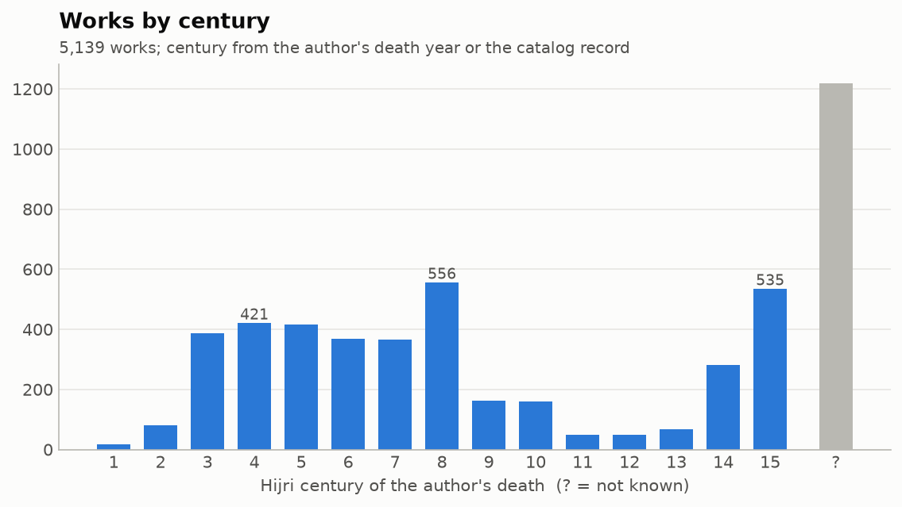
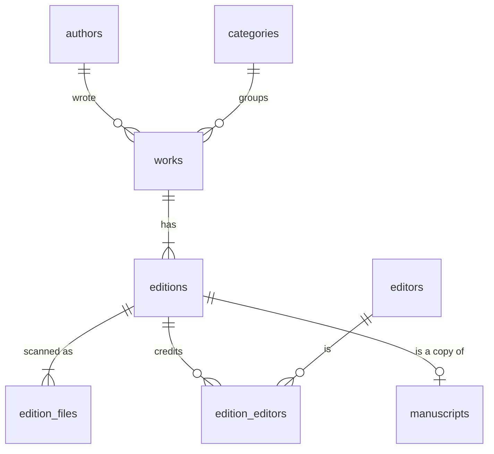
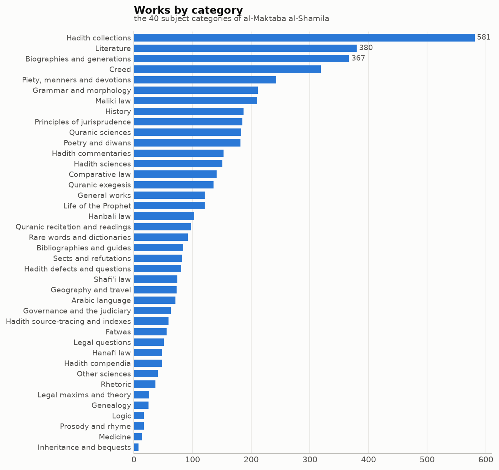
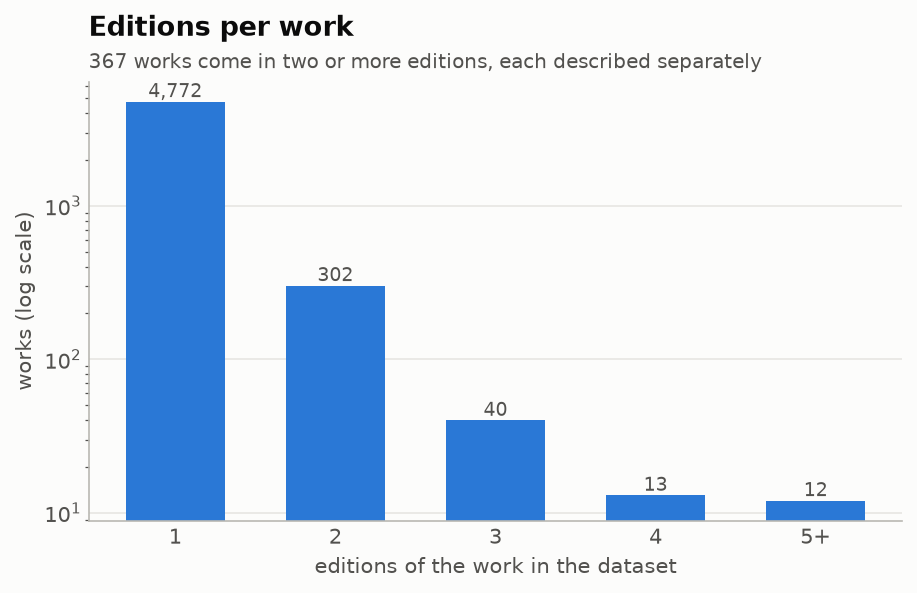
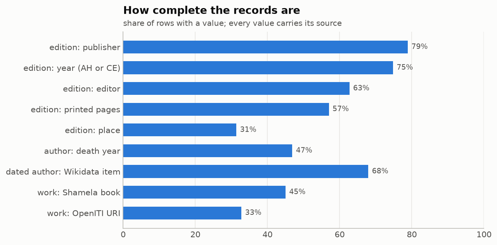
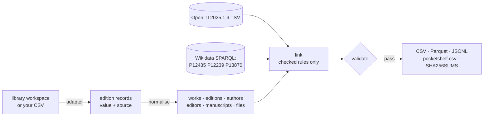

# turath-catalog

**An open dataset of classical Arabic works and their printed editions: who edited each edition, who
published it, where, when and in how many volumes, with the author's death year, a source for every value
and a confidence for every row.**

[](https://github.com/kmbenjel/turath-catalog/actions/workflows/ci.yml)
[](LICENSE-DATA)
[](LICENSE)
[](pyproject.toml)
[](https://huggingface.co/datasets/kmbenjel/turath-catalog)



| | |
|---|---|
| **5,139** works | **5,626** editions, **15,079** scan files with exact sizes |
| **2,643** authors, **1,239** with a sourced death year (AH, with the CE range) | **2,265** editors and other contributors, **4,012** credits |
| **31** manuscript copies, 25 with their holding library | links: **1,685** OpenITI URIs, **842** Wikidata authors, **2,313** Shamela books |

Every edition was checked while building a 16,700-volume library of Arabic scans; 2,230 of them were
read from the title page by eye. The dataset is **metadata only**: no scans, no text.

## Quickstart

```bash
pip install "turath-catalog[pandas]"
turath-catalog info sample
python -c "import turath_catalog as tc; print(tc.load('sample', 'editions', as_pandas=True).head())"
```

The package carries a 150-work sample (`load("sample")`); the full tables come as CSV, Parquet and JSON
Lines from the [GitHub release](https://github.com/kmbenjel/turath-catalog/releases) or Hugging Face:

```python
from datasets import load_dataset
editions = load_dataset("kmbenjel/turath-catalog", "editions", split="train")
```

```python
import pandas as pd
works = pd.read_parquet("turath-catalog-0.1.0/parquet/works.parquet")
eds = pd.read_parquet("turath-catalog-0.1.0/parquet/editions.parquet")
tabari = works.loc[works.title_ar == "جامع البيان عن تأويل آي القرآن", "work_id"]
print(eds[eds.work_id.isin(tabari)][["editors_ar", "publisher_ar", "year_ah", "volumes"]])
```

## Why turath-catalog? How it compares

Open catalogs of Arabic heritage describe **texts** (OpenITI), **people and works as linked data**
(Wikidata) or **one digitised edition per book** (Shamela). Researchers who cite a printed edition, and
librarians who must tell two printings apart, need the edition itself as a row. Cells checked on
2026-11-13 against each source's current data or terms; "–" = not checked.

| | **turath-catalog** 0.1.0 | OpenITI / KITAB metadata 2025.1.9 | Wikidata | Shamela catalogue | Arabic Collections Online | WorldCat |
|---|---|---|---|---|---|---|
| Printed edition as a row (editor, publisher, place, year, volumes) | ✓ 5,626 | ✗ free-text `ed_info` only | partial: 1,054 items with a Shamela edition id | partial: one edition per book | – | ✓ |
| Several editions of one work, grouped | ✓ 367 works | ✗ versions are digital texts | partial (P629) | ✗ | – | – |
| Death year in Hijri, with its source | ✓ AH + CE range + source + confidence | ✓ AH (in the URI) | partial: CE (P570) | ✓ | – | – |
| Source of each value, confidence of each row | ✓ | ✗ | partial (statement references) | ✗ | – | – |
| Manuscript holding library | ✓ 25 of 31 copies | ✗ | – | ✗ | – | – |
| Open licence | **CC BY 4.0** | CC BY-NC-SA 4.0 | CC0 | none stated | scans open; metadata licence not stated | terms bar bulk reuse |
| Bulk download | ✓ CSV, Parquet, JSONL | ✓ TSV | ✓ dumps, SPARQL | desktop app database | none found | ✗ |
| Links to the other catalogs | ✓ OpenITI, Wikidata, Shamela, Waqfeya | partial | ✓ P12435, P12239, P13870 | ✗ | – | – |

What the numbers show (`bench/compare.sh`, results in [`bench/results.json`](bench/results.json)):

1. **Editions, not just works.** 63% of editions name the editor, 79% the publisher, 75% the year,
   61% the volume count. OpenITI 2025.1.9 has no column for any of these: 10,552 of its 13,368 Arabic
   versions carry a free-text edition note. For 609 of our 1,550 editor-credited editions of works that
   OpenITI holds, the editor's name appears nowhere in OpenITI's notes.
2. **It adds to the open record.** Of 2,730 works by authors who died by 1300 AH, 1,100 have no OpenITI
   book we could match; 2,826 of 5,139 works have no Shamela book; 5,517 of 5,626 editions have no
   Wikidata item. (Lower bounds: a work we could not match may exist under another title.)
3. **Every value says where it came from.** `field_sources` names the source of each value (title page,
   imprint page, a catalog record linked by exact file size, the same-edition Shamela card, the file
   label), and each edition has `confidence` high (title page read by eye: 2,230), medium (3,021) or low (375).
4. **Links you can trust.** Wikidata links go through identifiers, never name search: Wikidata's Shamela
   author id (P12435) plus a death-year check, which kept 842 authors and turned down 86 whose dates
   disagree. OpenITI links need the same death year, the same title and an agreeing author name.
5. **Checked and reproducible.** `turath-catalog validate` checks types, unique ids, orphans, counts,
   Hijri↔Gregorian consistency and leaks (paths, e-mails, URLs, credentials); two builds from the same
   inputs give byte-identical files (`SHA256SUMS`).

**When to use something else.** For full texts and text reuse, use OpenITI and the KITAB tools. To
search a book's text, use Shamela. For world library holdings of a printed book, WorldCat. To read
public-domain scans, Arabic Collections Online. For a linked-data graph across all of history, Wikidata
(and add your links there: our `wikidata_qid` and `ext_ids` make that a join).

## What is inside



| table | rows | one row per |
|---|---:|---|
| `works` | 5,139 | text by an author, with OpenITI URI, Wikidata QID, Shamela ids |
| `editions` | 5,626 | printing, lithograph, thesis, offprint or manuscript copy of a work |
| `authors` | 2,643 | person; one name with two death years = two people |
| `editors` | 2,265 | person credited on an edition (shorter name forms merged, kept as variants) |
| `edition_editors` | 4,012 | credit: edition × person × role (editor, commentator, compiler, corrector, introducer, translator, supervisor) |
| `manuscripts` | 31 | manuscript copy with holding library, shelfmark and a printed edition of the same work |
| `edition_files` | 15,079 | scan file: volume label and exact byte size (no file names) |
| `categories` | 40 | subject category of al-Maktaba al-Shamila, with an English name |

Every column is documented in the [data dictionary](docs/data-dictionary.md); JSON Schemas for each row
are in [`schema/`](schema). One edition, as the tables give it:

| column | value | source |
|---|---|---|
| `work_id` · `title_ar` | `w_92c7dcdccd` · آداب الفتوى والمفتي والمستفتي | |
| author | النووي, d. **676 AH** (1277–1278 CE) · `0676Nawawi` · `Q293571` | Shamela book record |
| `editors_ar` | بسام عبد الوهاب الجابي (`role` editor, تحقيق) | title page |
| `publisher_ar` · `place_ar` | دار الفكر · دمشق | title page |
| `year_ah` · `year_ce` · `edition_number` | 1408 · 1988 · 1 | catalog record (size-linked) · title page |
| `volumes` · `pages` | 1 · 96 | catalog record (size-linked) |
| `openiti_uri` · `ext_ids` | `0676Nawawi.AdabFatwa` (high) · `shamela:6345`, `waqfeya:66a88e01…` | |
| `confidence` | high (title page read by eye) | |

| | |
|---|---|
|  |   |

## How it is built



```bash
make release WORKSPACE=~/library   # inputs -> releases/turath-catalog-0.1.0 (validated, checksummed)
make charts                        # docs/media/*.png from the release
make bench                         # bench/results.json: coverage against OpenITI, Wikidata, Shamela
```

Ids are stable hashes, not row numbers: `work_id = "w_" + sha1(title_key|author_key)[:10]`, the same
recipe that [turath-match](https://github.com/kmbenjel/turath-match) uses for its clusters and
[arabic-bib](https://github.com/kmbenjel/arabic-bib) for its keys, so the three join without a lookup
table. `pocketshelf.csv` is ready for [pocketshelf](https://github.com/kmbenjel/pocketshelf), which
turns it into one offline HTML catalog.

### Bring your own catalog

Any library can be normalised into the same tables, ids and checks:

```bash
turath-catalog build --csv my-library.csv --out my-release
turath-catalog validate my-release
```

One row per edition; only `title` is required. Columns: `title, author, author_death_ah, category,
editors` (`;`-separated, optionally `role:name`), `publisher, place, year_ah, year_ce, edition_number,
volumes, pages, kind, work, sizes, verified`. The build links your works to OpenITI and your authors to
Wikidata by the same rules.

## Provenance and what is left out

The library's own readings (title pages, imprint pages, file labels) are the first source. Two outside
catalogs supplement them, each only where it describes the same edition: a
[Waqfeya](https://waqfeya.net) record linked to the scan by its exact file size, and the book card of
[al-Maktaba al-Shamila](https://shamela.ws) when its editor (or publisher) matches. Only facts are taken:
names, titles, years, counts. Left out by design:

- descriptions, biographies and blurbs from any catalog; OCR text; notes and review comments;
- file names and paths (sizes are kept), download links and anything about the private workspace;
- 151 editions whose sources disagree and 116 whose title or author is under review; 125 titles not in
  Arabic script;
- values that fail a check: 166 death years where two people may share a name, 48 outside the century
  the catalog gives, 32 pairs of Hijri and Gregorian years that disagree, 80 "editor" values that are not
  a person's name.

The counts are in each release's `build-report.json`; details in [docs/provenance.md](docs/provenance.md).

## Design decisions

- **Edition as the unit, work as the join.** Scholars cite editions; the work row only groups them.
- **No guessed values.** A death year needs a Shamela record of the same work or two agreeing witnesses;
  a link needs an identifier crosswalk or year + title + author agreement. Empty beats wrong.
- **Hijri first.** Years are stored as printed (AH), with the Gregorian range the Hijri year overlaps
  (`death_ce_from`, `death_ce_to`) rather than a rounded single year.
- **Stdlib core.** Building and validating need only Python; Parquet, pandas and charts are extras.
- **Small repository.** Code, schemas, docs and a sample live in git; full tables ship as release assets.

## Roadmap

- More editions as their sources are reconciled; a publisher authority (one id per publishing house).
- Wikidata: missing edition items (P629, P98, P123) prepared as a QuickStatements batch for review.
- OpenITI version ids at edition level where the digital text names the same printed edition.
- A Hugging Face Space to browse and filter the tables.

## Contributing, citing, licence

Corrections are welcome: open an issue with the edition id and the title-page evidence (see
[CONTRIBUTING.md](CONTRIBUTING.md)). Cite with [CITATION.cff](CITATION.cff). Data: [CC BY 4.0](LICENSE-DATA);
code: [MIT](LICENSE). Arabic documentation: <https://warraq.benjelloun.dev/turath-catalog/>.

Part of **Warraq** (الورّاق), open tools for Arabic libraries:
[safha](https://github.com/kmbenjel/safha) ·
[planfs](https://github.com/kmbenjel/planfs) ·
[arabic-bib](https://github.com/kmbenjel/arabic-bib) ·
[turath-match](https://github.com/kmbenjel/turath-match) ·
[pocketshelf](https://github.com/kmbenjel/pocketshelf) ·
[agent-workbench](https://github.com/kmbenjel/agent-workbench).
