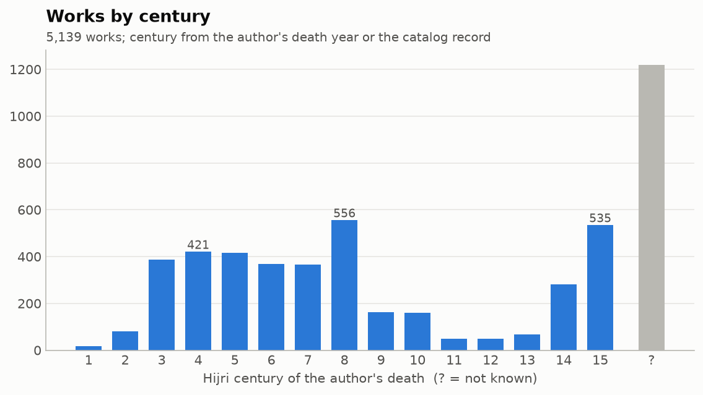

# فهرس التراث (turath-catalog)

«فهرس التراث» مجموعة بيانات مفتوحة تصف كتب التراث العربي **وطبعاتها المطبوعة**: من حقّق كل طبعة، ومن
نشرها، وأين، ومتى، وفي كم مجلد، وما سنة وفاة المؤلف بالهجري وما يقابلها بالميلادي. وكل معلومة فيها
مقرونة بمصدرها، وكل طبعة بدرجة الثقة فيها. وهي بيانات وصفية فقط: لا ملفات كتب فيها ولا نصوص.

## ماذا فيها؟

| الجدول | العدد | كل صف فيه |
|---|---:|---|
| الكتب (`works`) | 5,134 | كتاب لمؤلف، مع روابطه في OpenITI وويكي بيانات والشاملة |
| الطبعات (`editions`) | 5,626 | طبعة أو طبعة حجرية أو رسالة جامعية أو مستل أو نسخة مخطوطة |
| المؤلفون (`authors`) | 2,643 | صيغة اسم لمؤلف (والمؤلفون 2,451)، ولـ 1,239 منها سنة وفاة موثقة |
| المحققون (`editors`) | 2,265 | من ذُكر على طبعة، شخصًا أو هيئة، محققًا أو شارحًا أو جامعًا أو مصححًا أو مقدّمًا أو مترجمًا |
| المخطوطات (`manuscripts`) | 31 | نسخة مخطوطة، ومعها الخزانة التي تحفظها في 25 منها |
| ملفات الطبعات (`edition_files`) | 15,079 | مجلد مصوَّر بحجمه الدقيق بالبايت، لتعرف نسختك إن كانت عندك |

## لمن هي؟

- **للباحث والطالب** الذي يريد أن يعرف طبعات كتاب ما ومحققيها قبل أن يختار ما يحيل عليه.
- **للمكتبي والمفهرس** الذي يحتاج أسماء المحققين والناشرين وسنوات الطبع موحّدة، وسنوات الوفاة بالتقويمين.
- **لمن يعمل في معالجة العربية حاسوبيًا**: أسماء أعلام، وعناوين، وتواريخ هجرية، وروابط إلى OpenITI وويكي بيانات.

## من أين جاءت؟

جُمعت هذه الطبعات وفُحصت واحدة واحدة في أثناء بناء مكتبة شخصية من 16,700 مجلد مصوَّر، وقُرئت صفحة العنوان
بالعين في 2,230 طبعة منها. ثم استُكملت المعلومات من سجلات «الوقفية» المطابقة للملف نفسه في حجمه، ومن بطاقة
«المكتبة الشاملة» إذا كانت للطبعة نفسها. التفصيل في [المصادر والثقة](guides/sources.md).

## الصفحات

- [التثبيت والحصول على البيانات](install.md)
- [البدء السريع](quickstart.md)
- [ما الذي يميّزه؟](why.md)
- [بنية الجداول](guides/schema.md)
- [فهرسك أنت في الجداول نفسها](guides/own-catalog.md)
- [المصادر والثقة وما استُبعد](guides/sources.md)
- [أسئلة شائعة](faq.md)
